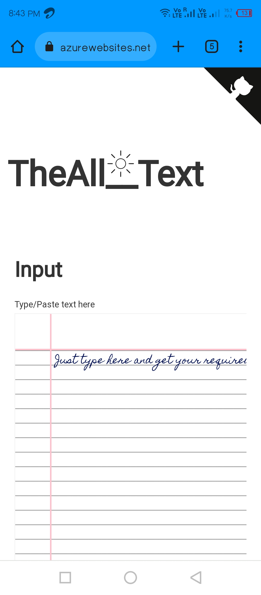

# TheAll_Text ✍️

**Type it. Handwrite it.** TheAll_Text turns typed text into realistic
handwritten pages that you can download as images or a single PDF.

**Live site:** https://nikhil-k-u.github.io/TheAll_Text/

Everything runs in your browser. Your text is never uploaded anywhere.



## Features

- **Handwriting fonts:** Homemade Apple, Caveat, Liu Jian Mao Cao and
  Kruti Dev (Hindi), or upload your own `.ttf` / `.otf` font
- **Ink colours:** blue, black, red and green presets, or pick any colour
- **Text controls:** font size, vertical position, word and letter spacing
- **Paper:** margin lines, ruled lines, a custom paper background image,
  and shadow or scanner effects
- **Multi-page:** long text is split across as many pages as needed
- **Diagrams:** draw with mouse, touch or pen and drop the drawing onto the page
- **Export:** save single pages as JPG or download every page as one PDF
- Light and dark theme, remembered between visits

## Project structure

```
index.html            Page markup
css/styles.css        All styles (design tokens, layout, paper)
js/main.js            Entry point: wires everything together
js/preview.js         Style controls → live page preview
js/generator.js       Splits text into pages and captures them as images
js/gallery.js         Generated pages list (reorder, remove, save)
js/pdf.js             PDF export
js/drawpad.js         Diagram drawing pad
js/theme.js           Light / dark theme
js/utils.js           Shared helpers
js/vendor/            html2canvas and jsPDF (bundled, no CDN needed)
tests/                Playwright end-to-end tests
```

## Development

Requires [Node.js](https://nodejs.org/) 18 or newer.

```bash
npm install
npm run dev        # http://localhost:5000
npm run lint
npm run format
npm test           # runs the Playwright tests
```

The site is plain HTML, CSS and JavaScript modules with no build step.
It deploys to GitHub Pages automatically on every push to `main`.

## Credits

Built by [Nikhil Kumar](https://github.com/Nikhil-K-u).
Originally based on
[text-to-handwriting](https://github.com/saurabhdaware/text-to-handwriting)
by Saurabh Daware (MIT). Uses [html2canvas](https://html2canvas.hertzen.com/)
and [jsPDF](https://github.com/parallax/jsPDF).

## License

[MIT](LICENSE)
