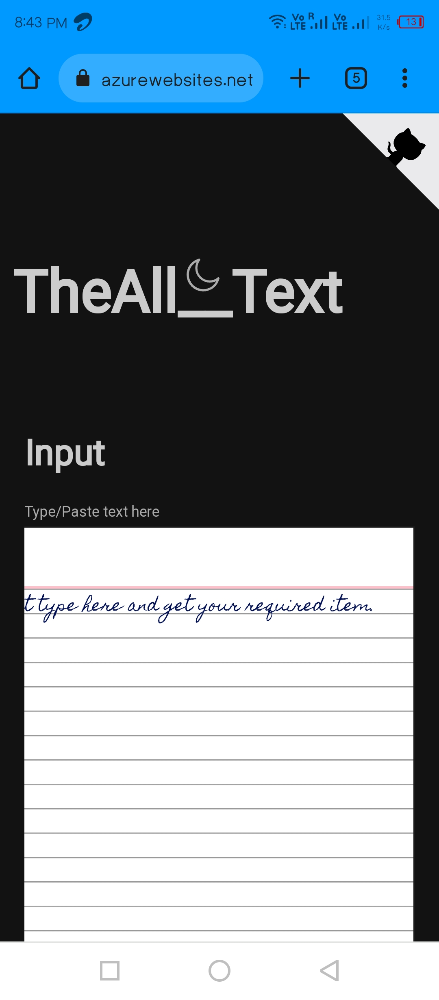
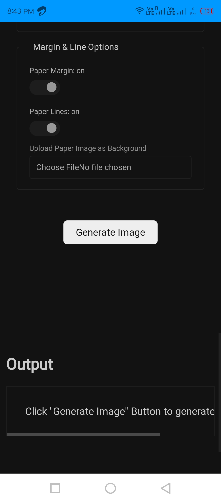

# TheAll_Text
It is a tool which help to change your text  or speech into Handwriting.
I have used Visual studio and azure webapp to build this project.



Here is how the text image is generated.
.jpeg)
Thank you.
Future ready talent

## Running locally
The app is plain HTML/CSS/JS (ES modules), so it must be served over HTTP (opening `index.html` directly from disk will not load the modules).

```bash
npm install
npm run dev
```

Then open http://localhost:5000.


## Features
- Type or paste text onto the page preview and click **Generate Image**
- Long text is automatically split across multiple pages
- Choose handwriting font (or upload your own), ink colour, font size, spacing, margins, lines, effects and resolution
- Upload a paper image as the background
- Draw diagrams and add them to the page
- Download each page as an image or all pages as a single PDF
- Light/dark theme (remembered between visits)
